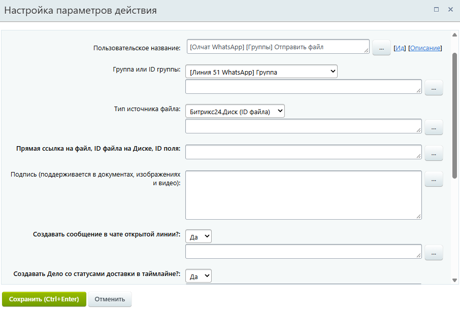
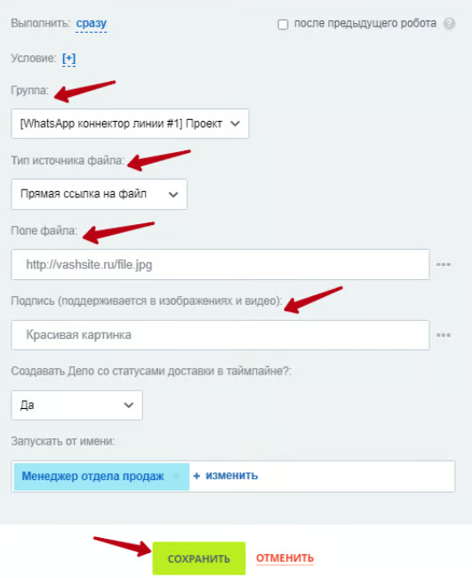

# Отправка файла в группу

### Действие (активити) «Отправка файла в группу»

Используйте данное активити для отправки файлов в любую из подключенных групп. Добавьте действие «Отправка файла в группу» и выполните его настройку.

Выполните настройку параметров действия:

1. Укажите **Группу,** в которую планируете сделать отправку.
2. В зависимости от того, где расположен файл который вы хотите отправить, в поле **«Тип источника файла»** из выпадающего списка выберите нужный пункт.
3. В поле **«Поле файла»** укажите прямую ссылку на файл, ID файла на Диске или ID поля сущности.
4. При необходимости в поле **«Подпись»** укажите текст, который будет прикреплён к отправляемому файлу. Поддерживается в изображениях и видео.

<figure><figcaption></figcaption></figure>

Остальные настройки можно оставить по умолчанию.

### Робот «Отправка файла в группу»

Робот «Отправка файла в группу» позволяет создавать автоматизированные сценарии для отправки файлов в подключенные группы при переходе лида или сделки в определённый статус. Для добавления робота перейдите в **Роботы**, выберите стадию лида или сделки, при переходе в которую должен сработать робот, и добавьте его через меню **Свои роботы — \[Олчат — Чаты и Группы WhatsApp] WhatsApp - Отправка файла в группу.** Выполните настройку робота и нажмите на кнопку «СОХРАНИТЬ» в меню робота и в общем окне роботов.

<figure><figcaption></figcaption></figure>


Подробнее о настройке отправки в зависимости от выбора источника расположения файла вы можете ознакомиться в статье [Настройка отправки файла в зависимости от источника](https://docs.olchat.io/roboty-i-aktiviti/sozdanie-pryamoi-ssylki-na-fail#sozdanie-pryamoi-ssylki-na-fail).

