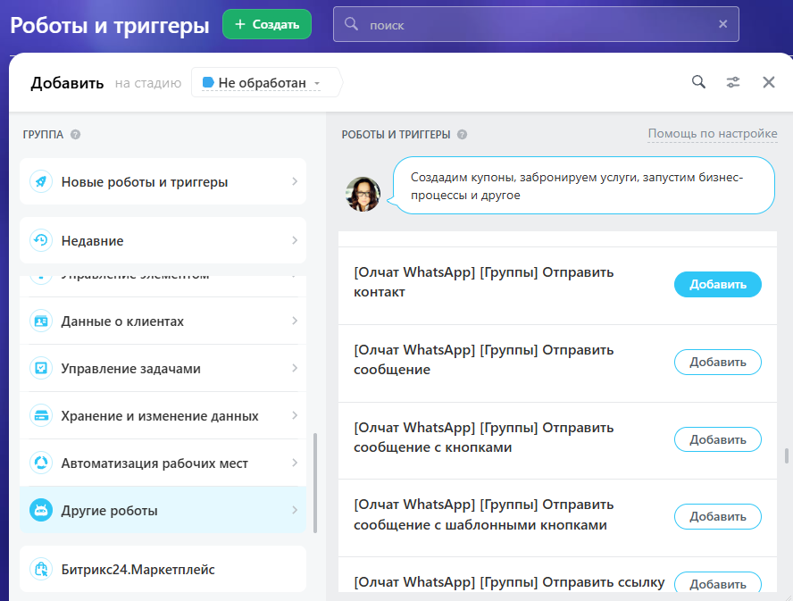
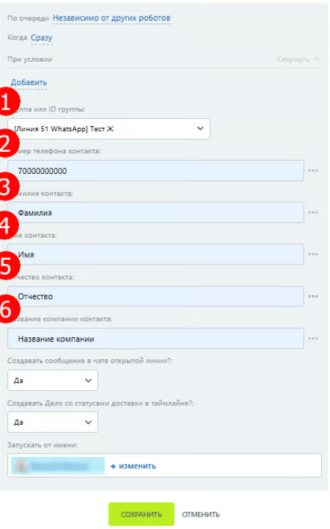

# Отправка контакта в группу

Робот «\[Олчат] \[Группы] Отправить контакт» позволяет создавать автоматизированные сценарии для отправки карточки контакта в подключенные группы при переходе лида или сделки в определённый статус.

Для добавления робота необходимо:



Перейти в раздел «Роботы» из списка лидов, либо карточки лида в CRM (в системе управления взаимоотношениями с клиентами).

<figure><figcaption></figcaption></figure>

<figure><figcaption></figcaption></figure>



Нажмите «+ Создать»; укажите стадию, на которой должен срабатывать робот; из списка меню выберите «Другие роботы» и нажмите «Добавить» напротив «\[Олчат] \[Группы] Отправить контакт».

<figure><figcaption></figcaption></figure>



Настройте робота.

1. Укажите группу, в которую будет отправляться карточка контакта.
2. Введите содержание карточки контакта: укажите номер телефона в международном формате (7 или +7), фамилию, имя и отчество контакта, а также компанию.
3. Нажмите «Сохранить».


Если необходимой группы нет в списке, обновите роботов в настройках приложения Олчат.


<figure><figcaption></figcaption></figure>


Заполнять все поля карточки контакта необязательно. Например, можно заполнить только имя или название компании.




Настройка робота завершена.

В чате открытой линии, связанной с группой, отправленная роботом карточка контакта будет выглядеть так:

<figure><figcaption></figcaption></figure>

В чате WhatsApp карточка контакта будет иметь следующий вид:

<figure><figcaption></figcaption></figure>

При нажатии на карточку:

<figure><figcaption></figcaption></figure>


