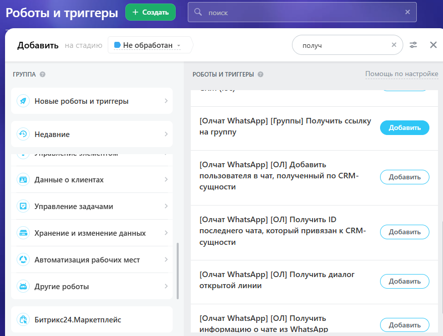
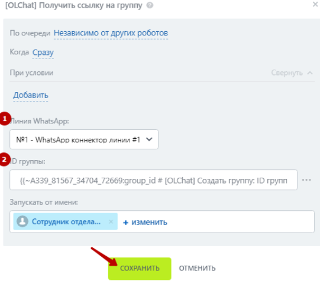
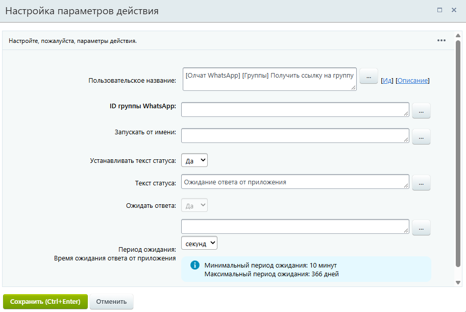

# Получение ссылки на группу

## Настройка робота

Для получения ссылки на группу добавьте робота «\[Олчат] Получить ссылку на группу». Для этого перейдите в **Роботы ‒ Создать ‒ Выбор стадии ‒ Другие роботы ‒ \[Олчат] Получить ссылку на группу ‒ Добавить.**

<figure><figcaption></figcaption></figure>

Выполните настройку робот&#x430;**.** Для этого на добавленном роботе нажмите на кнопку «изменить», чтобы открыть интерфейс редактирования робота:

1. Укажите **Линию WhatsApp,** через которую планируете получить ссылку на группу.
2. Укажите **ID (идентификатор) группы.** Получить ID группы можно из дополнительных результатов робота [Broken link](/broken/pages/ieq04Uoj0EnsU6mGP2xn "mention").

<figure><figcaption></figcaption></figure>

Остальные настройки можно оставить по умолчанию. Нажмите на кнопку «СОХРАНИТЬ».

## Настройка активити (действия) бизнес-процесса

Для получения ссылки на группу из бизнес-процесса добавьте действие «\[Олчат] Получить ссылку на группу». Выполните настройку параметров действия:

1. Укажите **Линию WhatsApp,** через которую планируете получить ссылку на группу.
2. Укажите **ID группы.** Получить ID группы можно из дополнительных результатов робота [Broken link](/broken/pages/ieq04Uoj0EnsU6mGP2xn "mention").

<figure><figcaption></figcaption></figure>

Остальные настройки можно оставить по умолчанию. Нажмите на кнопку «Сохранить».
