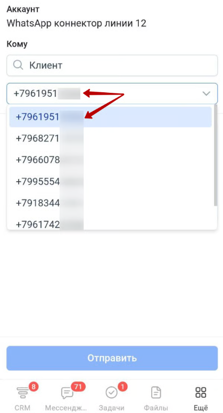
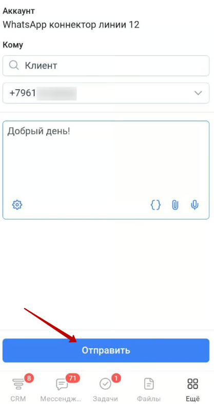
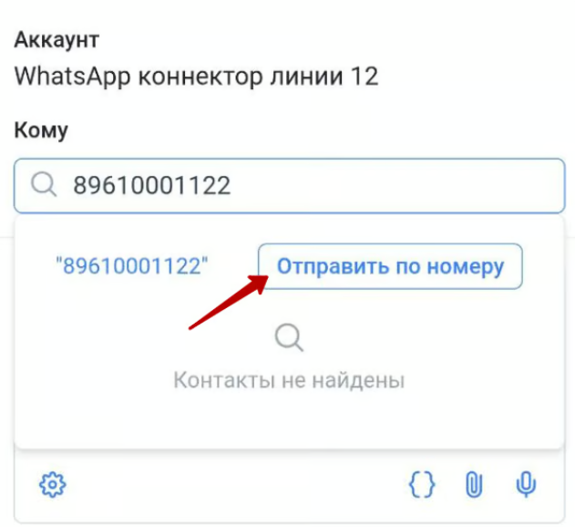

# Отправка сообщений из мобильного приложения Битрикс24

### Отправка через приложение Олчат

Чтобы отправить сообщение из мобильного приложения Битрикс24, в нижнем меню приложения необходимо перейти в раздел **Ещё – Маркет ‒ Олчат.**

Откроется страница приложения Олчат, на которой необходимо:

* В поле **Аккаунт** можно выбрать коннектор, с которого будет отправлено сообщение.
* В поле **Кому** – ввести фамилию или имя контакта, как он записан, или номер телефона в любом формате (начиная с +7, 7 или 8). Система произведёт поиск по сущности Контакты на основании введённых вами данным и подсветит все совпадения. После этого необходимо выбрать номер телефона для отправки. Если в найденном контакте указано несколько номеров телефонов – вы можете выбрать, на какой из телефонов отправить сообщение.
*

    <figure><figcaption></figcaption></figure>

    <figure><figcaption></figcaption></figure>
* В поле **Сообщение** необходимо ввести текст сообщения.

После заполнения нажмите на кнопку «Отправить».

<figure><figcaption></figcaption></figure>

Также в поле Сообщение доступно:

<figure><figcaption></figcaption></figure>

* { } – Вставка шаблонов. Поскольку поиск идёт по контактам, необходимо использовать шаблоны с параметрами из контактов.
* 📎 – Отправка файлов.
* **🎙️ –** Запись и отправка голосового сообщения.
* ⚙️ – Вызов меню с дополнительными настройками. Настройка позволяет управлять тем, будет ли сообщение, отправленное через виджет, опубликовано в чате открытой линии. Если чек-бокс «Публиковать в чат» активирован, то сообщение не только зафиксируется в таймлайне карточки, но и появится в чате открытой линии.

<figure><figcaption></figcaption></figure>

Кроме отправки на номера, которые уже занесены в базу CRM (системы управления взаимоотношениями с клиентами), можно совершить отправку также и на номер, которого в базе нет. При этом в приложении отобразится кнопка «Отправить по номеру»:

<figure><figcaption></figcaption></figure>

После нажатия на кнопку, приложение выведет следующее уведомление: «Номер не найден в CRM. При отправке сообщения может быть создан лид или сделка, в зависимости от настроек Открытой линии».

<figure><figcaption></figcaption></figure>

### Отправка через функционал СМС

<figure><figcaption></figcaption></figure>

Для отправки сообщения с помощью функционала СМС из мобильного приложения Битрикс24 войдите в раздел CRM (системы управления взаимоотношениями с клиентами), в сущность, из которой планируете сделать отправку. Затем перейдите в «Таймлайн» и нажмите на синюю кнопку со знаком плюс. Из представленного списка выберите «Отправить СМС». Затем нажмите на шестерёнку и в качестве провайдера для отправки укажите номер, подключенный с помощью нашего приложения Олчат. Введите текст сообщения и нажмите на кнопку «Отправить».

Как включить возможность отправлять сообщения через наше приложение с помощью функционала СМС [читайте здесь](https://docs.olchat.io/ispolzovanie/poluchenie-i-otpravka-soobshenii/kak-napisat-pervym-sms#vklyuchenie-provaidera-sms-i-osobennosti-metoda).
