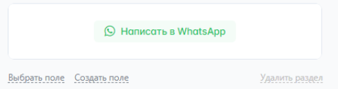
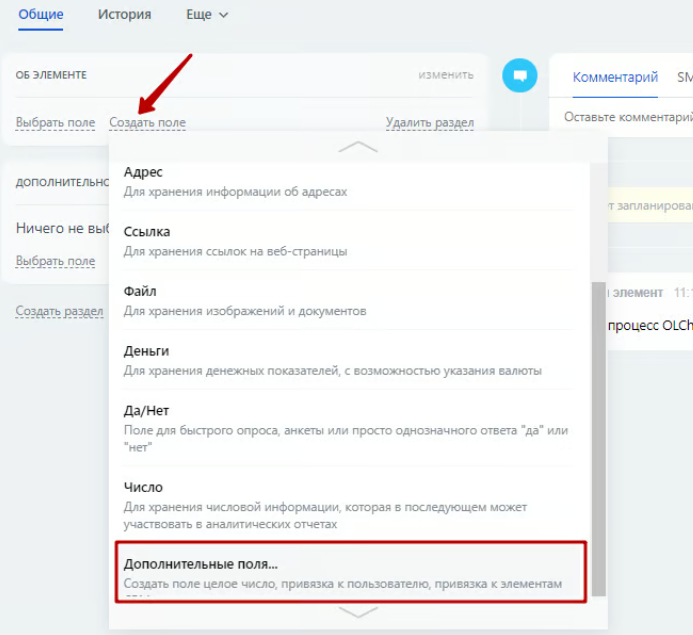
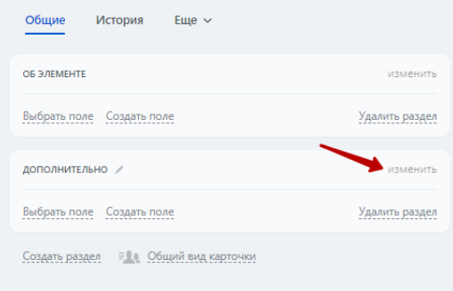
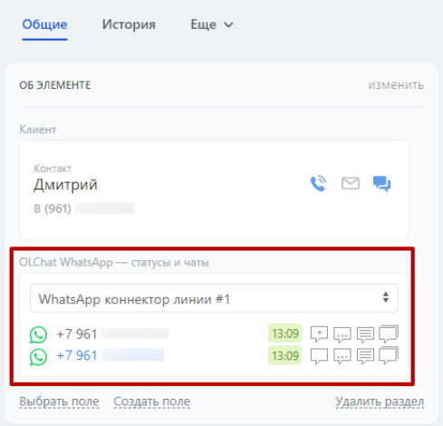

# Виджеты в карточках CRM (системы управления взаимоотношениями с клиентами) и Смарт-процессах

### Виджет «[vidzhet-statusy-i-chaty.md](vidzhet-statusy-i-chaty.md "mention")»

Виджет «Олчат — статусы и чаты» информирует о том, на каких номерах клиента установлен WhatsApp, показывает, в каком регионе зарегистрирован номер клиента, предоставляет информацию об операторе и времени клиента. Также виджет обеспечивает быстрый доступ из карточки любой сущности к выбору линии, созданию нового чата, переходу в уже созданный чат, к истории чата и к самому приложению, позволяет отправить сообщение клиенту прямо из карточки CRM (системы управления взаимоотношениями с клиентами), не переходя в основное приложение.

### Виджет «[vstroika-v-kartochku-zvonka.md](vstroika-v-kartochku-zvonka.md "mention")»

Виджет «Встройка в карточку звонка» позволяет отобразить информационное окно с историей чата с клиентом в момент вызова, если у вас подключена телефония.

### Как включить и выключить виджеты

Включить виджеты можно в настройках приложения: «Олчат» — «Настройки» — «Возможности»**.** Установите галочку в списке «Виджеты в карточках CRM» напротив виджета «Статусы и чаты» и виджета «Встройка в карточку звонка». Отключение виджетов производится путём снятия соответствующих галочек.

<figure><figcaption></figcaption></figure>


После включения виджета «Статусы и чаты» в настройках, можно переходить к добавлению виджета в карточку. Виджет в разделе «Поставщики» пока не поддерживается. В Канбане виджет также не должен отображаться.

Виджет «Встройка в карточку звонка» в дополнительных настройках не нуждается.


### Как показать виджет «Статусы и чаты» в карточке CRM (системы управления взаимоотношениями с клиентами)

Для того, чтобы показать виджет в карточке, зайдите в неё и нажмите на кнопку «Выбрать поле».

<figure><figcaption></figcaption></figure>

В открывшемся списке полей установите галочку напротив «Олчат WhatsApp— статусы и чаты» и нажмите на кнопку «ВЫБРАТЬ»:

<figure><figcaption></figcaption></figure>

Нажмите на кнопку «Написать в WhatsApp»**.** Виджет отобразится и будет готов к работе.

<figure><figcaption></figcaption></figure>

### Как показать виджет «Статусы и чаты» в карточке Смарт-процесса

Для того, чтобы показать виджет в карточке Смарт-процесса, выполните следующие действия.

#### 1. В карточке Смарт-процесса создайте пользовательское поле с типом **Олчат WhatsApp — статусы и чаты**

Для этого нажмите на кнопку **Создать поле ‒ Дополнительные поля...**

<figure><figcaption></figcaption></figure>

В выпадающем списке **«Тип данных»** выберете тип **Олчат WhatsApp — статусы и чаты.** В поле **«Название»** укажите название поля и нажмите на кнопку **«СОХРАНИТЬ».**

<figure><figcaption></figcaption></figure>

#### 2. Войдите в режим редактирования карточки и установите виджет

Для входа в режим редактирования карточки нажмите на кнопку И**зменить.**

<figure><figcaption></figcaption></figure>

При первой загрузке (до установки виджета в карточку Смарт-процесса), вы увидите надпись **«Вы в режиме редактирования»,** кнопку: **«ВКЛ. ВСТРОЙКУ Олчат ДЛЯ СМАРТ-ПРОЦЕССА»** и иконку **«Обновить данные виджета».**

<figure><figcaption></figcaption></figure>

Нажмите на кнопку **«ВКЛ. ВСТРОЙКУ Олчат ДЛЯ СМАРТ-ПРОЦЕССА»** для завершения процесса установки виджета в карточку Смарт-процесса.

<figure><figcaption></figcaption></figure>

Виджет **«Олчат WhatsApp — статусы и чаты»** установлен.

<figure><figcaption></figcaption></figure>

При повторных загрузках карточки в режиме редактирования, в виджете останется только надпись **«Вы в режиме редактирования»** и иконка **«Обновить данные виджета».**

<figure><figcaption></figcaption></figure>


Нажатие на иконку **«Обновить данные виджета»** очищает данные поля виджета.

Обновление данных можно использовать в том случае, если вы столкнулись с некорректным отображением номеров в виджете. Например, добавили клиента с номером WhatsApp в карточку, но в виджете он не появился.

Чтобы обновить данные виджета нажмите на иконку **«Обновить данные виджета»** и затем обязательно сохраните изменения нажатием на кнопку **«СОХРАНИТЬ»** в карточке Смарт-процесса.


<figure><figcaption></figcaption></figure>


Кроме добавления виджета в карточку смарт-процесса, с помощью описанных выше действий в меню карточки в таймлайне добавляется ссылка на приложение Олчат, при клике на которую открывается окно приложения для отправки сообщений из карточки.

Подробнее о работе с приложением в карточке в статье [kak-napisat-pervym-cherez-prilozhenie-olchat-v-kartochke.md](../poluchenie-i-otpravka-soobshenii/kak-napisat-pervym-cherez-prilozhenie-olchat-v-kartochke.md "mention")

