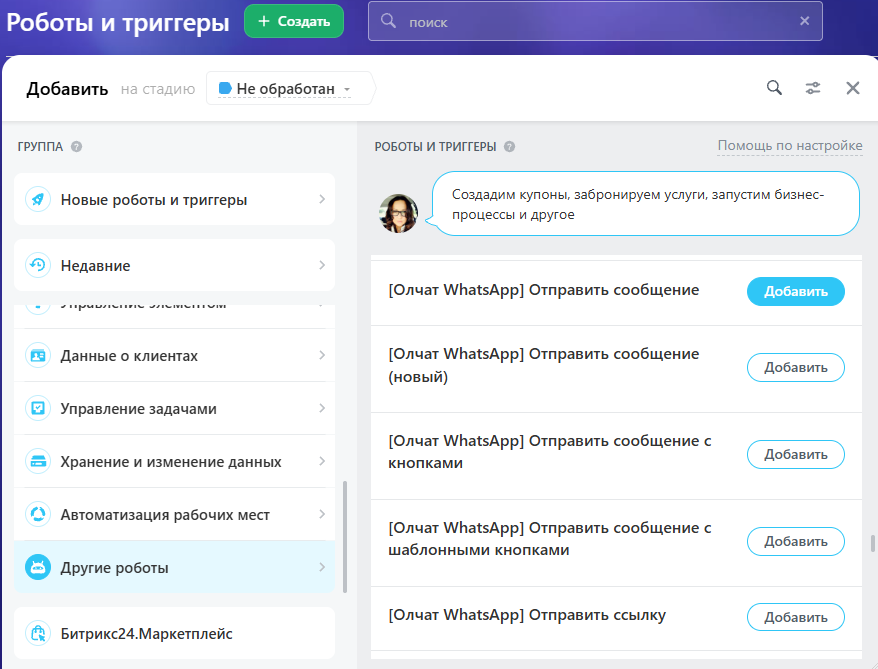
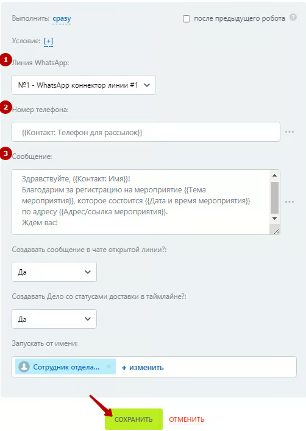
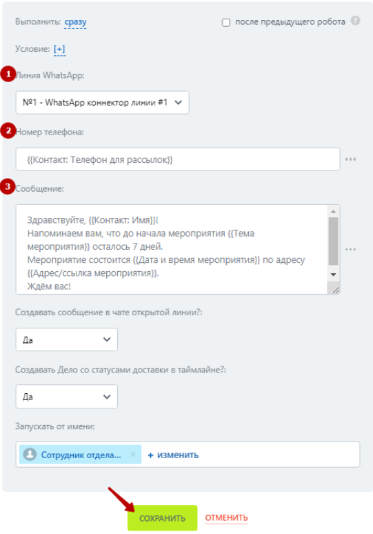
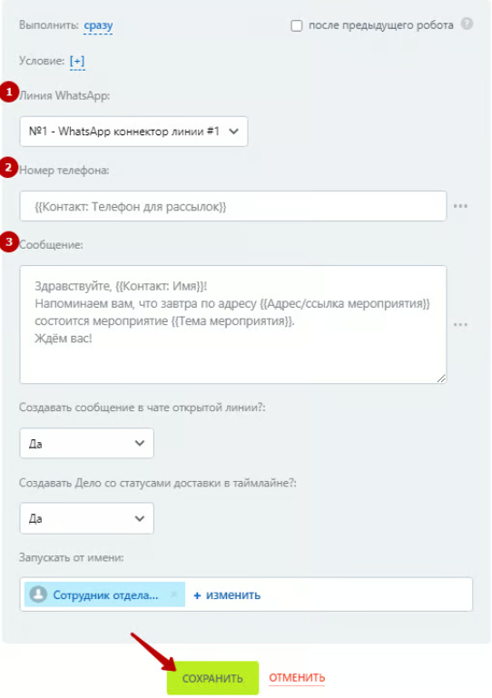
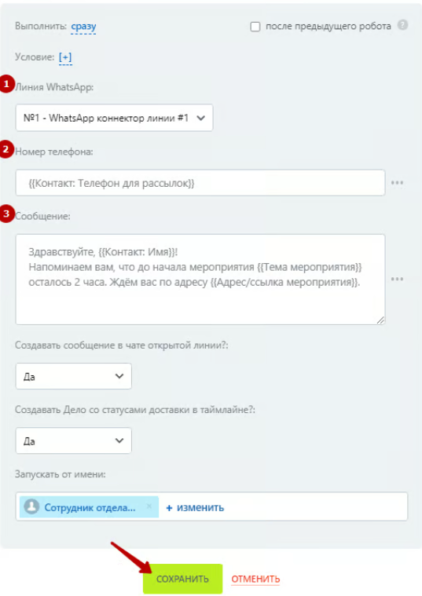

# Автоматизация воронки по мероприятиям с помощью уведомлений в WhatsApp

Если деятельность вашей компании связана с проведением различного рода мероприятий, таких как вебинары, семинары, выставки, конференции, форумы, и вам важно обеспечить сбор, хранение контактных данных и периодически напоминать участникам о том, что мероприятие состоится в определённую дату-время, вы можете настроить специальную воронку в вашем Битрикс24 и добавить несколько роботов для автоматизированного передвижения сделки по стадиям и отсылки сообщений в WhatsApp.

### Описание кейса

Рассмотрим следующую ситуацию. Вы получаете данные клиентов в CRM (в системе управления взаимоотношениями с клиентами) в раздел сделки в отдельную воронку Мероприятия с регистрационной формы вашего сайта или crm-формы. Воронка имеет следующий набор стадий:

<figure><figcaption></figcaption></figure>

* Новая регистрация.
* Регистрация подтверждена.
* Оповещений за 7 дней.
* Оповещение за 1 день.
* Оповещение за 2 часа.
* Мероприятие проведено.
* Посетил мероприятие (Успешная стадия сделки).
* Не посетил мероприятие (Не успешная стадия сделки).

В карточке сделки добавлены 3 пользовательских поля для подстановки значений из этих полей в робот отправки сообщения в WhatsApp: «Дата и время мероприятия», «Тема мероприятия», «Адрес/ссылка мероприятия».

<figure><figcaption></figcaption></figure>

После попадания сделки в CRM происходит автоматическое перемещение сделки по стадиям и отправка сообщений в WhatsApp в определённых стадиях. При перемещении сделки по стадиям, роботы ориентируются на значение, указанное в поле «Дата и время мероприятия».


Примем во внимание, что задача данного кейса показать общий функционал и возможности применения роботов в сфере автоматизации проведения мероприятий.

В рассматриваемой ситуации сбор регистраций на мероприятие начинается более чем за 7 дней до даты начала мероприятия. Поля «Дата и время мероприятия», «Тема мероприятия», «Адрес/ссылка мероприятия» предварительно заполнены. Роботы, используемые для настройки передвижения по воронке и уведомлений в WhatsApp не учитывают частные случаи и отклонения от вышеописанного сценария.

Для более гибкой настройки вы можете добавить дополнительные стадии, поля или условия срабатывания роботов.


### Настройка роботов в воронке мероприятия

Добавим несколько роботов, которые будут перемещать сделку по стадиям, ориентируясь на значение в поле «Дата и время мероприятия» и отсылать сообщения в WhatsApp.


Более подробная информация о настройке робота **«\[Олчат — Чаты и Группы WhatsApp] Отправка сообщения»,** используемого для отправки сообщений в WhatsApp, содержится в отдельной статье [otpravka-soobsheniya.md](../../roboty-i-aktiviti/roboty/otpravka-soobsheniya.md "mention").

Общая информация по работе с роботами в Битрикс24:\
[Роботы Битрикс24](https://helpdesk.bitrix24.ru/open/6908975/).


На стадию **«Новая регистрация»** добавим робота **«\[Олчат — Чаты и Группы WhatsApp] Отправка сообщения»,** в котором поблагодарим клиента за регистрацию, сообщим тему мероприятия, а также где и когда оно будет проходить. Данную информацию добавим из полей карточки сделки через функционал вставки значения.

<figure><figcaption></figcaption></figure>

<figure><figcaption></figcaption></figure>

Далее добавим робота, который сменит стадию на **«Регистрация подтверждена».**

<figure><figcaption></figcaption></figure>

Обязательно укажем, что робот должен сработать после предыдущего робота и стадию, на которую изменяем:

<figure><figcaption></figcaption></figure>

В стадии **«Регистрация подтверждена»** сделка должна оставаться до того момента, пока не наступит 7 дней до «Даты и время мероприятия», после чего она должна смениться на стадию **«Оповещение за 7 дней»**.

Добавим робота, который сменит стадию на **«Оповещение за 7 дней»** и выполним настройку времени срабатывания, как показано на скриншотах ниже:

<figure><figcaption></figcaption></figure>

<figure><figcaption></figcaption></figure>

В стадии **«Оповещение за 7 дней»** добавим робота **«\[Олчат — Чаты и Группы WhatsApp] Отправка сообщения»,** с помощью которого напомним клиенту о предстоящем мероприятии.

<figure><figcaption></figcaption></figure>

В текст сообщения добавим информацию из полей карточки сделки через функционал вставки значения:

<figure><figcaption></figcaption></figure>

Сделка должна оставаться в стадии **«Оповещение за 7 дней»** до того момента, пока не наступит 1 день до «Дата и время мероприятия», после чего она должна смениться на стадию **«Оповещение за 1 день»**. Для смены стадии добавим робота «Сменить стадию» и выполним его настройку, как показано на скриншотах ниже:

<figure><figcaption></figcaption></figure>

<figure><figcaption></figcaption></figure>

В стадии **«Оповещение за 1 день»** добавим робота **«\[Олчат — Чаты и Группы WhatsApp] Отправка сообщения»,** с помощью которого напомним клиенту о том, что мероприятие состоится уже завтра.

<figure><figcaption></figcaption></figure>

Сделка должна оставаться в стадии **«Оповещение за 1 день»** до того момента, пока не наступит 2 часа до «Дата и время мероприятия», после чего она должна смениться на стадию **«Оповещение за 2 часа»**. Для смены стадии добавим робота «Сменить стадию» и выполним его настройку, как показано на скриншотах ниже:

<figure><figcaption></figcaption></figure>

<figure><figcaption></figcaption></figure>

В стадии **«Оповещение за 2 часа»** добавим робота **«\[Олчат — Чаты и Группы WhatsApp] Отправка сообщения»,** с помощью которого напомним клиенту о том, что до начала мероприятия осталось 2 часа.

<figure><figcaption></figcaption></figure>

Также на стадию **«Оповещение за 2 часа»** можно добавить ещё одного робота, который сменит текущую стадию на стадию **«Мероприятие проведено».** Выполним его настройку, как показано на скриншотах ниже:

<figure><figcaption></figcaption></figure>

<figure><figcaption></figcaption></figure>

Итоговый набор роботов по стадиям может выглядеть следующим образом:

<figure><figcaption></figcaption></figure>


Также вы можете добавить роботов для отправки уведомлений в WhatsApp в стадиях «Посетил мероприятие» и «Не посетил мероприятие», например, для рассылки материалов с проведённого мероприятия.

