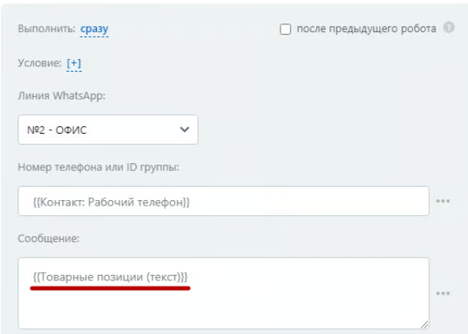

# Работа с товарными позициями

В роботах и активити бизнес-процессов вы можете использовать переменную **\{{Товарные позиции (текст)\}}** для того, чтобы отправить клиенту перечень товаров.

<figure><figcaption></figcaption></figure>

Переменную **\{{Товарные позиции (текст)\}}** можно добавить в сообщение воспользовавшись функцией вставка значения:

<figure><figcaption></figcaption></figure>

<figure><figcaption></figcaption></figure>

Сообщения, содержащие переменные с товарными позициями, в чате получателя выглядят так:

<figure><figcaption></figcaption></figure>
