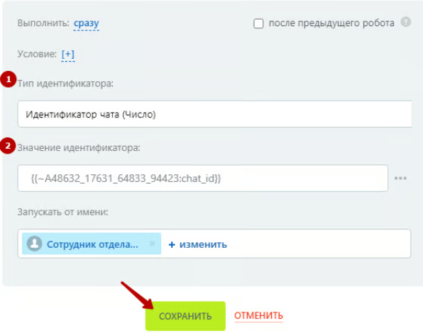
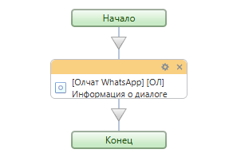
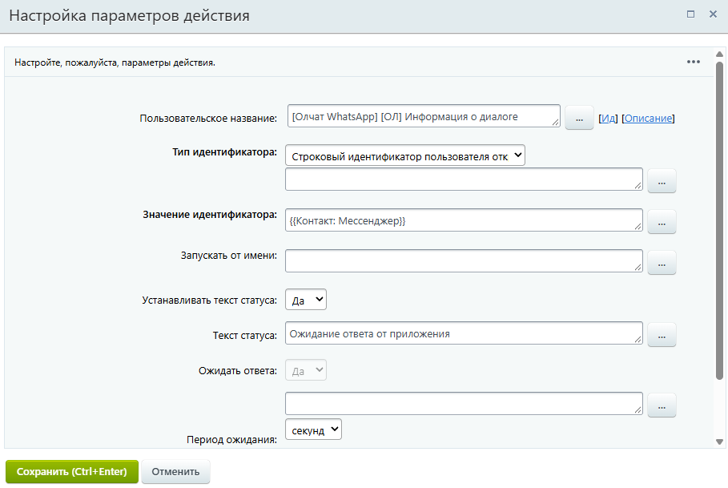
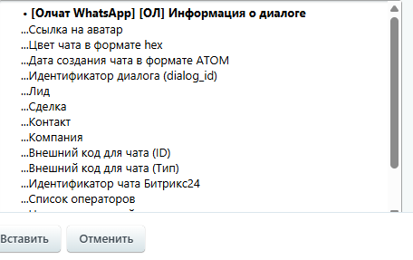

# Информация о диалоге

Робот и активити «\[Олчат — Чаты и Группы WhatsApp] \[ОЛ] Информация о диалоге» позволяют получить подробную информацию о диалоге по одному из типов идентификаторов:

* Идентификатор чата (Число).
* Идентификатор диалога (chatXXX).
* Строковый идентификатор пользователя открытой линии из поля мессенджер (например, imol|livechat|1|1373|211).


Получить ID чата и ID диалога можно из дополнительных результатов робота или активити [poluchit-informaciyu-o-chate-iz-whatsapp.md](poluchit-informaciyu-o-chate-iz-whatsapp.md "mention").

Строковый идентификатор пользователя открытой линии – содержится в поле Мессенджер.


<figure><figcaption></figcaption></figure>

### Настройка робота

Для добавления робота перейдите в **Роботы ‒ Создать ‒ Выбор стадии ‒ Другие роботы ‒ \[Олчат] \[ОЛ] Информация о диалоге ‒ Добавить.**

<figure><figcaption></figcaption></figure>

Выполните настройку робота. Для этого на добавленном роботе нажмите на кнопку «изменить», чтобы открыть интерфейс редактирования робота:

1. Укажите **Тип идентификатора.**
2. Введите **Значение идентификатора.\\**

<figure><figcaption></figcaption></figure>

Остальные настройки можно оставить по умолчанию. Нажмите на кнопку «СОХРАНИТЬ».

### Настройка активити (действия) бизнес-процесса

Для настройки активити в бизнес-процессе добавьте действие «\[Олчат] \[ОЛ] Информация о диалоге».

<figure><figcaption></figcaption></figure>

Выполните настройку параметров действия:

<figure><figcaption></figcaption></figure>

1. Укажите **Тип идентификатора.**
2. Введите **Значение идентификатора.**

Остальные настройки можно оставить по умолчанию. Нажмите на кнопку «Сохранить».


Вся информация о диалоге, которую можно использовать в дальнейших сценариях автоматизации, будет содержаться в дополнительных результатах робота или активити:


<figure><figcaption></figcaption></figure>
