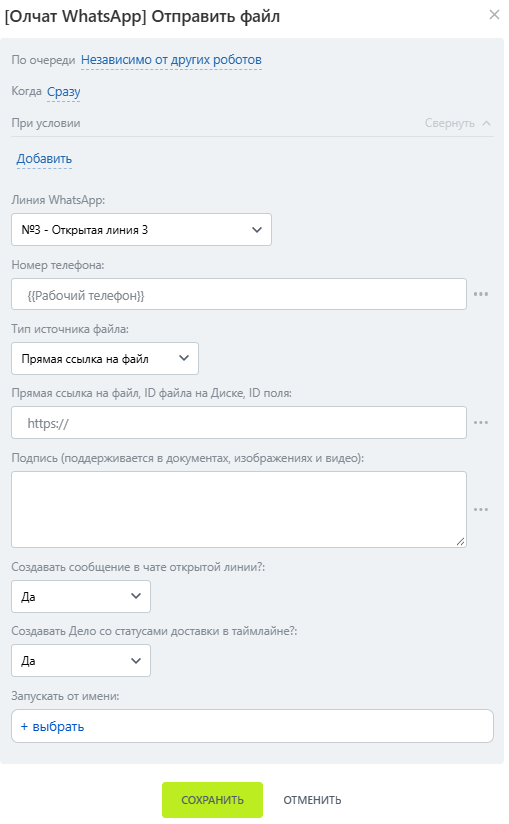
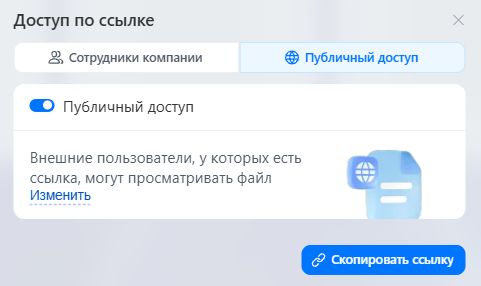
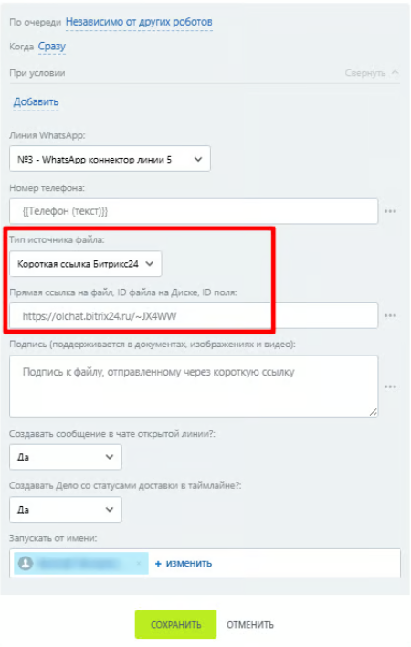
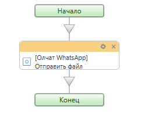
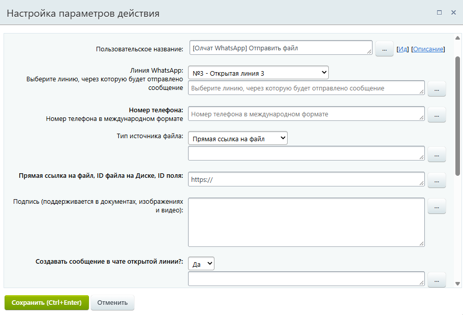
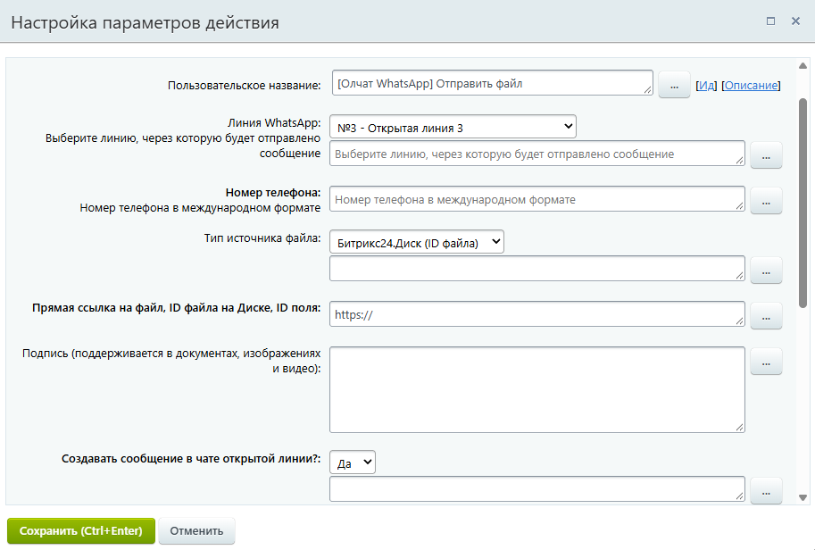
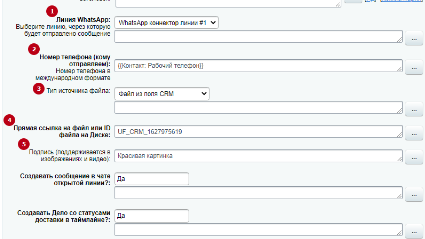

# Отправка файла

### Настройка робота

Чтобы отправить файл добавьте робота «\[Олчат — Чаты и Группы WhatsApp] WhatsApp Отправка файла». Для этого перейдите в **Роботы ‒ Создать ‒ Выбор стадии ‒ Другие роботы ‒ \[Олчат] Отправить файл ‒ Добавить.**

<figure><figcaption></figcaption></figure>

Выполните настройку робота. Для этого на добавленном роботе нажмите на кнопку «изменить», чтобы открыть интерфейс редактирования робота:

1. Укажите **Линию WhatsApp,** через которую планируете сделать отправку.
2. Введите **Номер телефона**, на который необходимо отправить сообщение.
3. В поле **«Тип источника файла»** из выпадающего списка выберите пункт «Прямая ссылка на файл», «Битрикс24.Диск (ID файла)», «Файл из поля CRM», «Короткая ссылка Битрикс24».
4. В зависимости от выбранного типа источника файла, в поле **«Прямая ссылка на файл, ID файла на диске, ID поля»** укажите прямую ссылку на файл, ID отправляемого файла или ID поля, в котором находится файл.
5. При необходимости в поле **«Подпись»** укажите текст, который будет прикреплён к отправляемому файлу. Поддерживается в документах, изображениях и видео.

Остальные настройки можно оставить по умолчанию. Нажмите на кнопку «СОХРАНИТЬ».

<figure><figcaption></figcaption></figure>

Если файл находится на Диске Битрикс24, использование короткой ссылки Битрикс24 в роботе «Отправка файл&#x430;**»** будет оптимальным. Для этого:

1. На Диске выберите необходимый файл и нажмите на него правой кнопкой мыши.
2. Выберите «Поделиться».
3. Нажмите «Скопировать ссылку».

<figure><figcaption></figcaption></figure>

В окне получения ссылки выберите «Доступ по ссылке», чтобы разрешить публичный доступ. Нажмите «Скопировать ссылку».

<figure><figcaption></figcaption></figure>


Для корректной работы робота "Отправка файла" нельзя устанавливать пароль на файл.


При настройке робота «Отправка файла», в поле «Тип источника файла» выберите «Короткая ссылка Битрикс24», а в поле «Прямая ссылка на файл, ID файла на Диске, ID поля» вставьте полученную ранее короткую ссылку.

<figure><figcaption></figcaption></figure>

### Настройка активити (действия) бизнес-процесса

Используйте это активити для отправки файла в WhatsApp.

<figure><figcaption></figcaption></figure>

Существует несколько вариантов выбора источника расположения файла.

#### Прямая ссылка на файл

Выполните настройку параметров действия:

1. Укажите **Линию WhatsApp,** через которую планируете сделать отправку.
2. Введите **Номер телефона**, на который необходимо отправить сообщение.
3. В поле **«Тип источника файла»** из выпадающего списка выберите пункт «Прямая ссылка на файл».
4. В поле **«Ссылка на файл, ID или поле сущности»** укажите прямую ссылку на файл.
5. При необходимости в поле **«Подпись»** укажите текст, который будет прикреплён к отправляемому файлу. Поддерживается в изображениях и видео.

Остальные настройки можно оставить по умолчанию.

<figure><figcaption></figcaption></figure>

#### **Отправка файлов из Битрикс24.Диск**

Выполните настройку параметров действия:

1. Укажите **Линию WhatsApp,** через которую планируете сделать отправку.
2. Введите **Номер телефона**, на который необходимо отправить сообщение.
3. В поле **«Тип источника файла»** из выпадающего списка выберите пункт «Битрикс24.Диск (ID файла)».
4. В поле **«Ссылка на файл, ID или поле сущности»** укажите ID отправляемого файла.
5. При необходимости в поле **«Подпись»** укажите текст, который будет прикреплён к отправляемому файлу. Поддерживается в изображениях и видео.

Остальные настройки можно оставить по умолчанию.

<figure><figcaption></figcaption></figure>

#### Отправка файла находящегося в поле CRM

Выполните настройку параметров действия:

1. Укажите **Линию WhatsApp,** через которую планируете сделать отправку.
2. Введите **Номер телефона**, на который необходимо отправить сообщение.
3. В поле **«Тип источника файла»** из выпадающего списка выберите пункт «Файл из поля CRM».
4. В поле **«Ссылка на файл, ID или поле сущности»** укажите ID поля, в котором находится файл.
5. При необходимости в поле **«Подпись»** укажите текст, который будет прикреплён к отправляемому файлу. Поддерживается в изображениях и видео.

Остальные настройки можно оставить по умолчанию.

<figure><figcaption></figcaption></figure>


Если вы запускаете процесс из одной сущности CRM, а файл, который необходимо отправить находится в другой, конструкция для указания пути к файлу должна выглядеть так: **LEAD|12..45|UF\_123.....89**, где:

* Указывается сущность, в карточке которой находится файл. Может принимать значения:\
  **LEAD** — лиды;\
  **DEAL** — сделки;\
  **CONTACT** — контакты;\
  **COMPANY** — компании;
* **12..45** — ID этой сущности (лида, сделки, контакта, компании).
* **UF\_123.....89** — ID поля.

Указанные части пути к файлу отделяются между собой символом **|.**


<figure><figcaption></figcaption></figure>


Подробнее о создании прямой ссылки на файл, способах указания ID отправляемого файла или ID поля, в котором находится файл, вы можете ознакомиться в статье [sozdanie-pryamoi-ssylki-na-fail.md](../sozdanie-pryamoi-ssylki-na-fail.md "mention").



Отправляется только размер файла до 100 мб. Если файл больше, то он не отправится.

