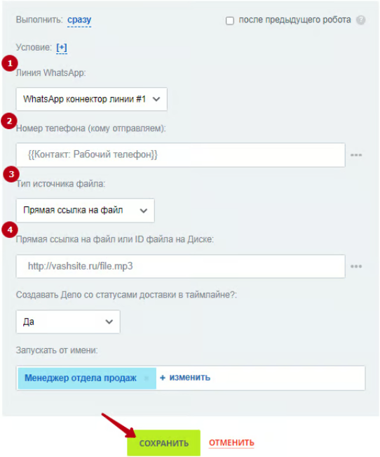
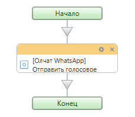

# Отправка голосового сообщения

### Настройка робота

Чтобы отправить аудиосообщение, добавьте робота «\[Олчат — Чаты и Группы WhatsApp] WhatsApp Отправка голосового сообщения». Для этого перейдите в **Роботы ‒ Создать ‒ Выбор стадии ‒ Другие роботы ‒ \[Олчат] Отправить голосовое сообщение ‒ Добавить.**

<figure><figcaption></figcaption></figure>

Выполните настройку робота. Для этого на добавленном роботе нажмите на кнопку «изменить», чтобы открыть интерфейс редактирования робота:

1. Укажите **Линию WhatsApp,** через которую планируете сделать отправку.
2. Введите **Номер телефона**, на который необходимо отправить аудиосообщение.
3. В поле **«Тип источника файла»** из выпадающего списка выберите пункт «Прямая ссылка на файл», «Битрикс24.Диск (ID файла)» или «ID поля сущности».
4. В зависимости от выбранного типа источника файла, в поле **«Ссылка на файл, ID или поле сущности»** укажите прямую ссылку на аудиофайл, ID отправляемого аудиофайла или ID поля, в котором находится аудиофайл.

Остальные настройки можно оставить по умолчанию. Нажмите на кнопку «СОХРАНИТЬ».

<figure><figcaption></figcaption></figure>

### Настройка активити (действия) бизнес-процесса

Активити «Отправка голосового сообщения» позволяет отправить аудиосообщение.

<figure><figcaption></figcaption></figure>

Для отправки аудиосообщения из бизнес-процесса добавьте действие «Отправка голосового сообщения». Выполните настройку параметров действия.

<figure><figcaption></figcaption></figure>

1. Укажите **Линию WhatsApp,** через которую планируете сделать отправку.
2. Введите **Номер телефона**, на который необходимо отправить аудиосообщение.
3. В поле **«Тип источника файла»** из выпадающего списка выберите пункт «Прямая ссылка на файл», «Битрикс24.Диск (ID файла)» или «ID поля сущности».
4. В зависимости от выбранного типа источника файла, в поле **«Ссылка на файл, ID или поле сущности»** укажите прямую ссылку на аудиофайл, ID отправляемого аудиофайла или ID поля, в котором находится аудиофайл.

Остальные настройки можно оставить по умолчанию.


Подробнее о создании прямой ссылки на файл, способах указания ID отправляемого файла или ID поля, в котором находится файл, вы можете ознакомиться в статье [sozdanie-pryamoi-ssylki-na-fail.md](../sozdanie-pryamoi-ssylki-na-fail.md "mention").



Размер отправляемого файла не должен превышать 25 Мб.

