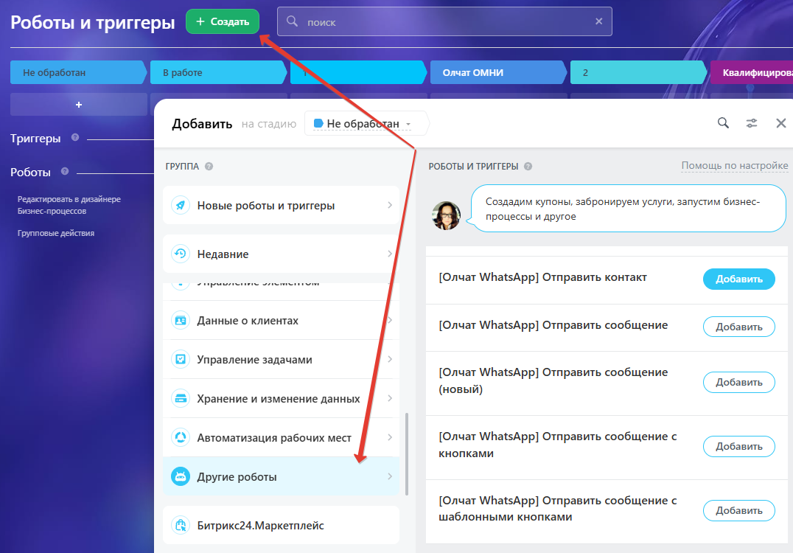
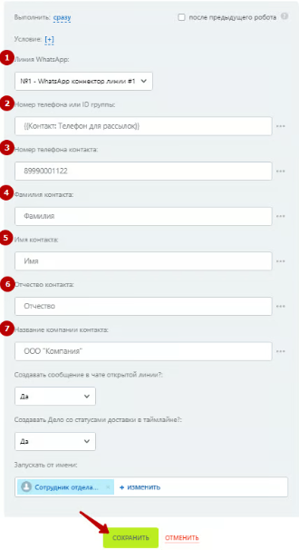
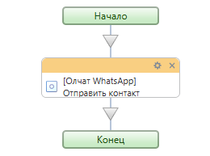
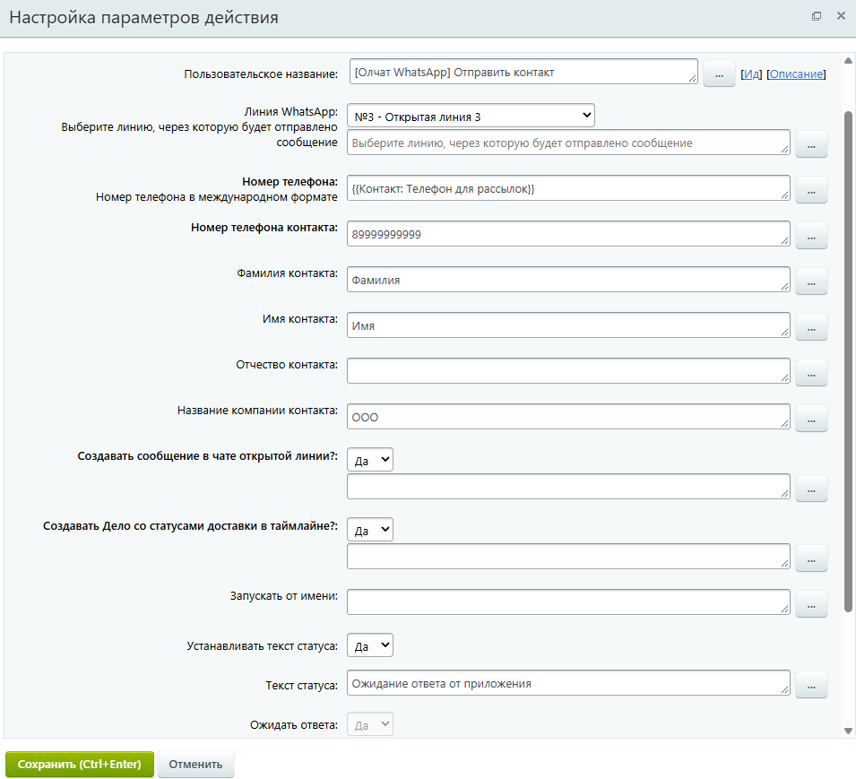

# Отправка контакта

### Настройка робота

Чтобы отправить контакт добавьте робота «\[Олчат — Чаты и Группы WhatsApp] WhatsApp Отправка контакта». Для этого перейдите в **Роботы ‒ Создать ‒ Выбор стадии ‒ Другие роботы ‒ \[Олчат] Отправить контакт ‒ Добавить.**

<figure><figcaption></figcaption></figure>

Выполните настройку робота. Для этого на добавленном роботе нажмите на кнопку «изменить», чтобы открыть интерфейс редактирования робота:

1. Укажите **Линию WhatsApp,** через которую планируете сделать отправку.
2. Введите **Номер телефона**, на который необходимо отправить сообщение.
3. Укажите **Номер телефона контакта.**
4. Укажите **Фамилию контакта.**
5. Укажите **Имя контакта.**
6. Укажите **Отчество контакта.**
7. Укажите **Название компании контакта.**

Остальные настройки можно оставить по умолчанию. Нажмите на кнопку «СОХРАНИТЬ».

<figure><figcaption></figcaption></figure>

### Настройка активити (действия) бизнес-процесса

<figure><figcaption></figcaption></figure>

Для отправки контакта из бизнес-процесса добавьте действие «Отправить контакт». Выполните настройку параметров действия:

1. Укажите **Линию WhatsApp,** через которую планируете сделать отправку.
2. Введите **Номер телефона**, на который необходимо отправить сообщение.
3. Укажите **Номер телефона контакта.**
4. Укажите **Фамилию контакта.**
5. Укажите **Имя контакта.**
6. Укажите **Отчество контакта.**
7. Укажите **Название компании контакта.**

<figure><figcaption></figcaption></figure>


Из заполненных данных система сформирует и отправит контакт — карточку, содержащую телефон, ФИО и название компании, если данные поля заполнены.


<figure><figcaption></figcaption></figure>

<figure><figcaption></figcaption></figure>
