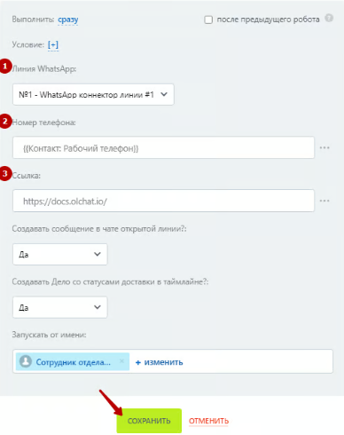
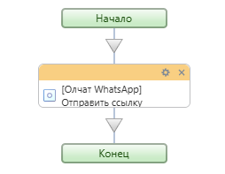
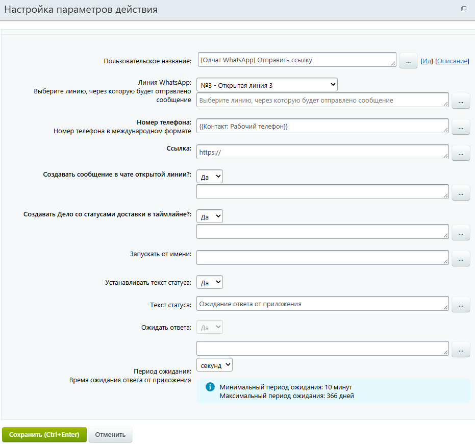

# Отправка ссылки

### Настройка робота

Чтобы отправить ссылку добавьте робота «\[Олчат — Чаты и Группы WhatsApp] - Отправка ссылки». Для этого перейдите в **Роботы ‒ добавить ‒ Свои роботы ‒ \[Олчат] - Отправить ссылку.** Робот позволяет сформировать и отправить ссылку с превью.

<figure><figcaption></figcaption></figure>

Выполните настройку робота:

1. Укажите **Линию WhatsApp,** через которую планируете сделать отправку.
2. Введите **Номер телефона**, на который необходимо отправить сообщение.
3. Укажите **Ссылку** на ресурс.

<figure><figcaption></figcaption></figure>


В данный момент настройка типа Короткая ссылка не работает.


Остальные настройки можно оставить по умолчанию. Нажмите на кнопку «СОХРАНИТЬ».

### Настройка активити (действия) бизнес-процесса

Активити «Отправка ссылки» позволяет отправить ссылку с превью.

<figure><figcaption></figcaption></figure>

Для отправки ссылки из бизнес-процесса добавьте действие «Отправка ссылки». Выполните настройку параметров действия.

<figure><figcaption></figcaption></figure>

1. Укажите **Линию WhatsApp,** через которую планируете сделать отправку.
2. Введите **Номер телефона**, на который необходимо отправить ссылку.
3. Укажите **Ссылку** на ресурс.

Остальные настройки можно оставить по умолчанию. Нажмите на кнопку «СОХРАНИТЬ».


Сообщение со ссылкой при получении в Whatsapp будет выглядеть следующим образом:


<figure><figcaption></figcaption></figure>
