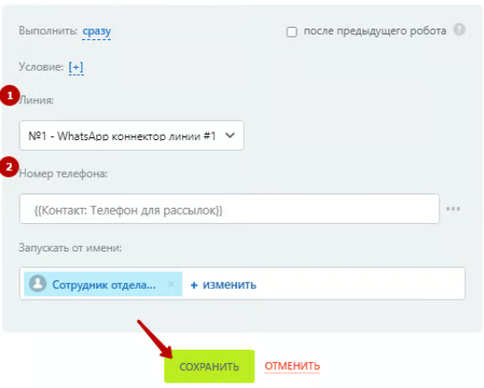
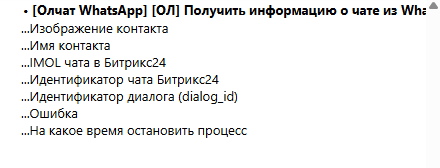

# Получить информацию о чате из WhatsApp

Робот «\[Олчат — Чаты и Группы WhatsApp] \[ОЛ] Получить информацию о чате из WhatsApp» позволяет получить подробную информацию о диалоге по номеру телефона.

Для добавления робота перейдите в **Роботы ‒ Создать ‒ Выбор стадии ‒ Другие роботы ‒ \[Олчат] \[ОЛ] Получить информацию о чате из WhatsApp ‒ Добавить.**

<figure><figcaption></figcaption></figure>

Выполните настройку робота. Для этого на добавленном роботе нажмите на кнопку «изменить», чтобы открыть интерфейс редактирования робота:

1. Укажите **Линию,** для которой осуществляется получение информации.
2. Введите **Номер телефона**, для которого осуществляется получение информации.

<figure><figcaption></figcaption></figure>

Остальные настройки можно оставить по умолчанию. Нажмите на кнопку «СОХРАНИТЬ».


Вся информация о чате, которую можно использовать в дальнейших сценариях автоматизации, будет содержаться в дополнительных результатах робота:


<figure><figcaption></figcaption></figure>
