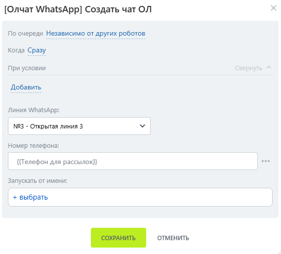
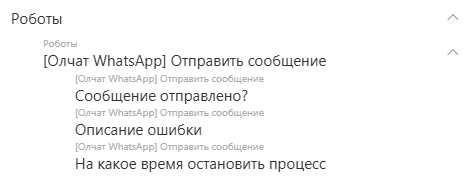

# Создание чата ОЛ

Робот «\[Олчат — Чаты и Группы WhatsApp] Создание чата ОЛ» позволяет создавать чат открытой линии для указанного номера телефона.

Для добавления робота перейдите в **Роботы ‒ Создать ‒ Выбор стадии ‒ Другие роботы ‒ \[Олчат] Создать чат ОЛ ‒ Добавить.**

<figure><figcaption></figcaption></figure>

Выполните настройку робота. Для этого на добавленном роботе нажмите на кнопку «изменить», чтобы открыть интерфейс редактирования робота:

1. Укажите **Линию WhatsApp,** для которой производится создание чата Открытой линии.
2. Введите **Номер телефона**, для которого будет создан чат.

<figure><figcaption></figcaption></figure>

Остальные настройки можно оставить по умолчанию. Нажмите на кнопку «СОХРАНИТЬ».

Робот произведёт создание чата открытой линии и прикрепит его к текущей сущности.


В дополнительных результатах робота содержится различная информация, которую можно использовать в дальнейших сценариях автоматизации:


<figure><figcaption></figcaption></figure>
