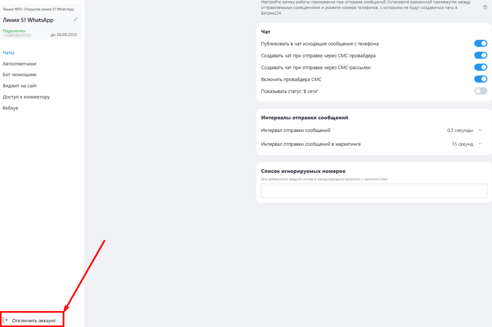

# Переавторизация аккаунта

Для того, чтобы перезагрузить коннектор, выполните следующие действия:



Откройте приложение Олчат.

<figure><figcaption></figcaption></figure>



Нажмите «» напротив коннектора, затем выберите «Настройки коннектора».

<figure><figcaption></figcaption></figure>



Нажмите «Отключить аккаунт» в левом нижнем углу.

<figure><figcaption></figcaption></figure>



Повторно подключите коннектор.

Воспользуйтесь [инструкцией](../podklyuchenie-konnektora.md), чтобы заново подключить коннектор.




Во время авторизации не выключайте устройство и не блокируйте экран. **П**риложение WhatsApp должно оставаться открытым до полной синхронизации. Рекомендуем после авторизации удерживать основное устройство активным в течение 3–5 минут — это необходимо для корректной загрузки всех данных аккаунта.

