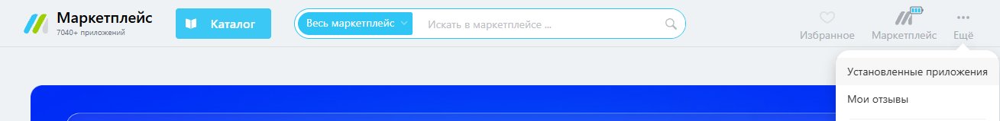

# Copy of Переустановка приложения

Для того чтобы переустановить приложение Олчат на вашем портале Битрикс24, необходимо сначала произвести удаление приложения, а затем установить его снова.


Для корректной работы после переустановки с удалением настроек, необходимо [обновить роботов](https://docs.olchat.io/roboty-i-aktiviti/roboty#ustanovka-robotov-i-aktiviti), [добавить бота в групповые чаты](https://docs.olchat.io/voprosy-i-otvety/rabota-s-gruppovymi-chatami/kak-dobavit-bota-v-gruppovoi-chat), если они у вас есть, и [перезагрузить (выключить и снова включить) Виджеты в карточках CRM (системы управления взаимоотношениями с клиентами](../ispolzovanie/vidzhety-v-kartochke-crm/#kak-vklyuchit-i-vyklyuchit-vidzhety).


### Удаление приложения

Чтобы удалить приложение перейдите в «Маркет» вашего Битрикс24, нажмите на кнопку «Ещё» → «Установленные приложения»:

<figure><figcaption></figcaption></figure>

В списке установленных приложений найдите приложение «Олчат — Чаты и Группы WhatsApp» и перейдите в него:

<figure><figcaption></figcaption></figure>

В окне приложения нажмите на кнопку «УДАЛИТЬ». В появившемся подтверждении об удалении установите галочку «удалить настройки и данные приложения» и подтвердите удаление, нажав на кнопку «УДАЛИТЬ».

<figure><figcaption></figcaption></figure>

Приложение «Олчат — Чаты и Группы WhatsApp» будет удалено с портала. После чего можно переходить к установке приложения.

### Установка приложения


Процесс установки приложения подробно описан в статье [ustanovka-prilozheniya.md](ustanovka-prilozheniya.md "mention").


### Восстановление работы групповых чатов

После переустановки приложения необходимо восстановить связь рабочих чатов Битрикс24 с соответствующими группами WhatsApp.

Для этого участник каждого рабочего чата должен повторно добавить в него бота **Олчат WhatsApp**.

1. Откройте рабочий чат группы в Битрикс24.
2. Перейдите в список участников чата и нажмите **Добавить**.
3. Найдите участника **Олчат WhatsApp** и добавьте его в чат.
4. Если в результатах поиска отображаются два участника с таким названием, добавьте обоих.
5. Повторите действия для каждого рабочего чата группы.
6. После добавления бота проверьте отправку сообщений из группы.

Добавить бота может только участник соответствующего рабочего чата. Если у вас нет доступа к чату, попросите одного из его участников выполнить эти действия.
